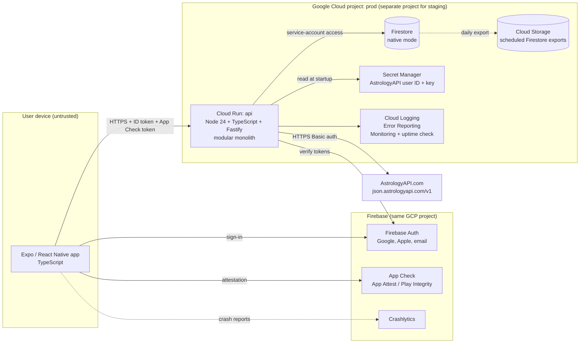
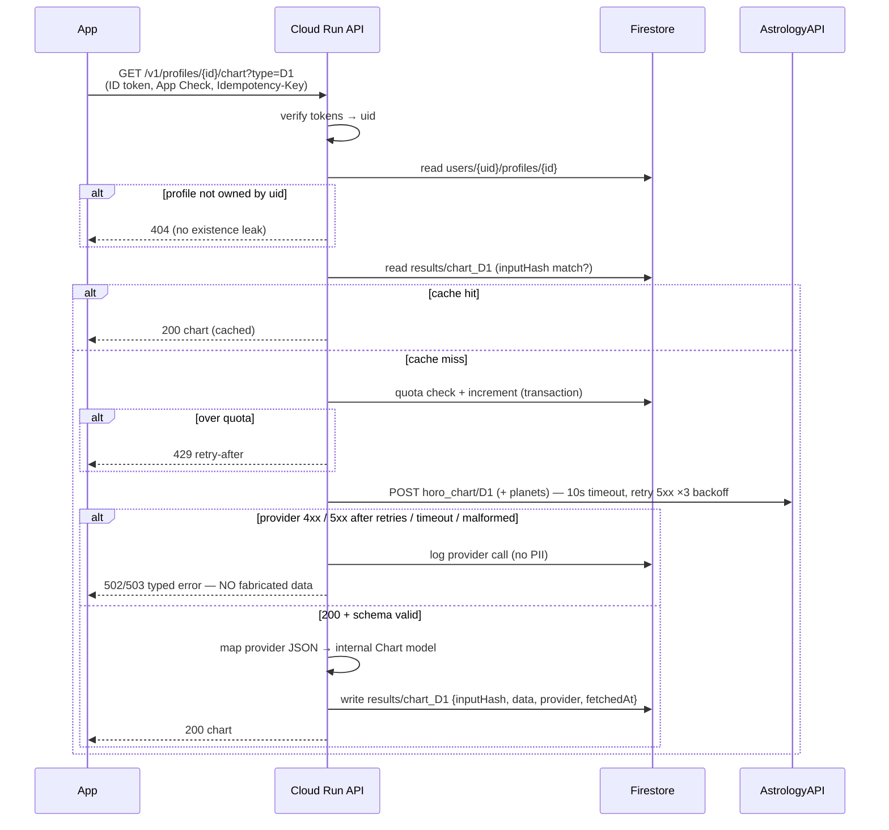
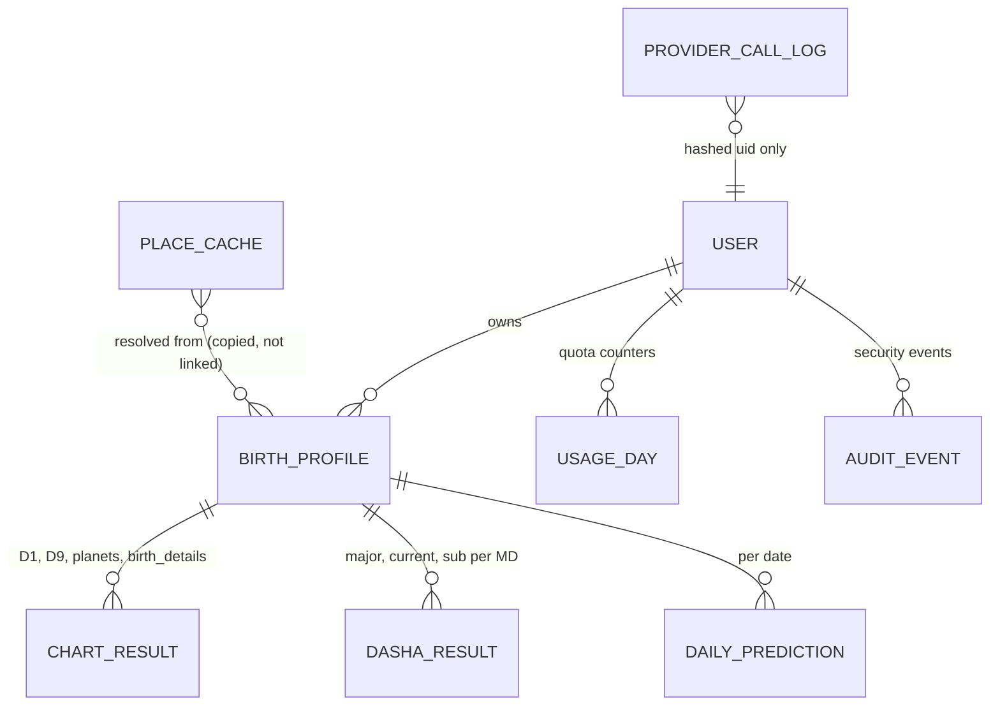
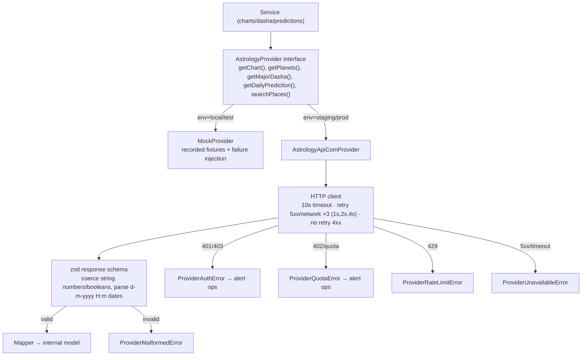

# Architecture Proposal (Phase 3)

- **Status:** Approved by the client on 2026-10-17. Decisions A1–A10 accepted. Database: Firestore. Auth: Google, Apple, and email + password. Git hosting: GitHub (account or org still to be confirmed).
- **Date:** 2026-10-17
- **Inputs:** `requirements.md` v0.2 and `api-provider-notes.md`

---

## 0. Current state (Phase 2 summary)

This is a **new project**, so there is no existing system to inspect or preserve. `D:\astrology` contained no files before the docs created in Phase 1.

| Tool | State on dev machine |
|---|---|
| Node.js | v24.13.0 ✔ |
| npm | 11.6.2 ✔ |
| git | 2.52 ✔. The project folder is **not** a git repository yet. |
| Docker | 29.3 ✔ |
| Java | 25 ✔. Needed by the Firebase emulators. |
| gcloud CLI | ✘ not installed |
| Firebase CLI | ✘ not installed |
| EAS CLI (Expo builds) | ✘ not installed |

There are no GCP projects, repos, or services to reuse. Cloud infrastructure was not inspected because none exists for this project yet.

---

## 1. Recommended architecture

The recommendation is a **modular monolith API on Cloud Run, with Firestore and Firebase Auth, and an Expo (React Native) app.**

**Why this shape**

- **A modular monolith on one Cloud Run service.** There is a single deployable unit with internal module boundaries. That is the simplest thing that meets the requirements at under 1,000 users. Cloud Run scales to zero, so it costs about $0 when idle.
- **All provider calls go through our API.** The provider says never to ship keys in the app, and NFR-1 requires the same. The API is also where caching, quota, and validation live.
- **Firestore is accessed only by the API.** Security rules deny all direct client access. There is one enforcement point for data isolation (NFR-3), and it is testable in plain unit and integration tests.
- **Firebase Auth plus App Check.** Auth identifies the user. App Check proves the request came from our genuine app, which protects provider credits from scripted abuse. Both are free at this scale.

---

## 2. Technology choices and alternatives

Each row is a decision for you to approve.

### 2.1 Mobile app: **Expo (React Native) + TypeScript** ✅ you preferred this
| Option | Verdict |
|---|---|
| **Expo (managed, EAS Build, expo-router)** | **Recommended.** One codebase for iOS and Android. Over-the-air JS updates. EAS handles signing and store submission. The team already knows it. |
| Bare React Native | More native control, which isn't needed. More setup. |
| Flutter / native | Rejected, because you chose React Native. |

The supporting libraries:
- **expo-router** for navigation.
- **TanStack Query** for server state and offline caching of fetched readings.
- **react-native-svg** for our own North Indian chart renderer.
- **zod** schemas shared with the backend.
- **@react-native-firebase** for auth, App Check, and Crashlytics. This needs an Expo *development build*, not Expo Go. That is normal for production apps.

### 2.2 Backend runtime: **Cloud Run (container)**
| Option | Pros | Cons |
|---|---|---|
| **Cloud Run, single service** (recommended) | Runs as a normal Node server locally and in tests. A single unit is easy to reason about. Scales to zero. Has a generous free tier. Portable (it's just Docker). | Cold start of about 1–2 s after idle. |
| Cloud Functions (2nd gen) | Least boilerplate. | Each function is its own island, which makes shared modules, local testing, and a modular monolith awkward. It runs on Cloud Run underneath anyway. |
| Firestore + client SDK only (no backend) | Cheapest. | **Not viable.** Provider keys would have to reach the client, or every call becomes a function anyway. Weak control over quotas. |

### 2.3 Backend framework: **Fastify + TypeScript**
| Option | Verdict |
|---|---|
| **Fastify** | **Recommended.** Small and fast. Built-in schema validation hooks. Easy to test with `inject()`. |
| NestJS | Strong module system, but heavy DI and decorators for an API of about 10 endpoints. |
| Express | Familiar, but weaker typing and validation out of the box. |

### 2.4 Database: **Firestore** (decision needed: Firestore or Postgres)
| Option | Monthly cost at under 1,000 users | Pros | Cons |
|---|---|---|---|
| **Firestore (native)** (recommended) | **≈ $0** (free tier is 50k reads and 20k writes per day, 1 GiB) | No server to manage. Fits the document-shaped data well, since provider results are JSON blobs per profile. Recursive delete makes account deletion simple. Has a TTL policy for caches. | Lock-in to GCP. Limited querying, which our access patterns don't need. Schema enforced in code (zod), not in the DB. |
| Cloud SQL Postgres (smallest) | ≈ $9–15 | Relational integrity, SQL, portable, mature migrations. | It's a server: maintenance windows, connections, and backups to configure. Uses 20–30% of the budget for little benefit at this scale. |

**Why Firestore wins here.** Our data is mostly "user → profiles → cached provider results". It is read by key and is not relational. The main cost of Firestore (weak ad-hoc queries) doesn't affect these access patterns. If analytics are needed later, Firestore exports to BigQuery.

### 2.5 Authentication: **Firebase Auth** (decision needed: email method)
- **Google and Sign in with Apple:** supported natively, and free.
- **Email:** Firebase has **no built-in 6-digit email OTP**, so FR-1 needs a choice:

| Option | Effort | Notes |
|---|---|---|
| **A. Email + password** (recommended) | Low | Includes standard reset and verification emails. Familiar to users. |
| B. Email link (passwordless) | Medium | Needs deep-link handling on both platforms and a hosting domain. Firebase Dynamic Links is shut down, so this needs the newer Hosting-based setup. |
| C. Custom email OTP | High | Needs our own OTP issuance, an email provider (cost), and rate limiting. Becomes custom security code we have to own. |
| D. Google + Apple only | None | Simplest, but excludes users who want neither. |

Alternatives to Firebase Auth (Auth0, Clerk, Supabase Auth) add a vendor and cost, with no advantage inside GCP.

### 2.6 Timezone resolution (decision needed)
| Option | Verdict |
|---|---|
| **A. Local IANA tzdb (Luxon) using the `timezone_id` from `geo_details`** (recommended) | Free and deterministic. Fully unit-testable, no provider call per profile. Phase 7 tests compare it against `timezone_with_dst` for a fixture set. Any mismatch is investigated before launch. |
| B. Provider `timezone_with_dst` for every profile | This is what the provider recommends. It costs a credit per profile, and a provider outage blocks profile creation. |

### 2.7 Caching and rate limiting (no Redis)
- **Chart and Dasha results** are deterministic for fixed inputs. They are stored permanently in Firestore under the profile and keyed by an *input hash*. If the birth data changes, the hash changes, so the cache is invalidated (FR-9).
- **Daily predictions** are stored per (profile, date).
- **Place search** results are cached in Firestore for 30 days (TTL). The app debounces typing (≥ 3 characters, 400 ms) so we don't spend a credit per keystroke.
- **Per-user quota:** a daily counter document updated in a Firestore transaction (NFR-5).
- **In-flight de-duplication:** each request carries an idempotency key, and writes are keyed by input hash. A duplicate or retried request never causes a second provider call or duplicate rows.
- **Memorystore/Redis was rejected.** It costs at least about $35/mo and isn't needed at this scale.

### 2.8 Observability and operations
| Concern | Choice | Cost |
|---|---|---|
| API logs | Structured JSON logging to Cloud Logging, with a redaction layer that strips birth data and tokens | Free tier |
| API errors | Cloud Error Reporting | Free |
| Uptime | Monitoring uptime check on `/healthz`, plus an email alert | Free |
| App crashes | Firebase Crashlytics | Free |
| Cost control | GCP budget alerts at $25 and $45. A provider-credit alert, polled daily if their API allows. | Free |
| Backups | Daily scheduled Firestore export to Cloud Storage, kept for 30 days. Restore drill done before launch. | Under $1 |

### 2.9 Environments and CI/CD
| Environment | What it is |
|---|---|
| **local** | Firebase emulators (Auth and Firestore), API on localhost, **mock provider**. Uses zero credits. |
| **staging** | Its own GCP/Firebase project. Real provider, development credits. Internal app builds (TestFlight internal and Play internal track). |
| **prod** | Its own GCP/Firebase project. Real provider, paid plan. Store builds. |

- **CI:** GitHub Actions runs lint, typecheck, unit and integration tests against emulators, a secret scan, and a Docker build. **Deploy:** staging deploys on merge to `main`. Prod deploys from a tagged release with manual approval. Deploys authenticate with Workload Identity Federation, so there are no long-lived GCP keys in CI.
- **Mobile:** EAS Build and EAS Submit. The free tier has a slow queue and a monthly build cap. We can upgrade later if it becomes a bottleneck.
- **Open question:** where will the git repository live? GitHub is assumed.

---

## 3. Component responsibility map

The API is a modular monolith. Each module owns its routes, service logic, and Firestore access. Modules only talk to each other through exported service interfaces.

| Module | Responsibility | Depends on |
|---|---|---|
| `auth` | Verifies the Firebase ID token and App Check token, and attaches `uid` to the request. Account-deletion endpoint. | Firebase Admin |
| `users` | User document, consent record, and the account deletion cascade. | birth-profiles |
| `places` | Place search (via provider geo), the place cache, and IANA timezone to UTC offset (Luxon). | astrology-provider |
| `birth-profiles` | CRUD with a cap of 5. Validation (dates, unknown time). Computes the input hash and UTC instant. | places |
| `charts` | D1, D9, planets, and birth details. Cache lookup, then generation. Maps provider data to our internal model. | astrology-provider, quota |
| `dasha` | Mahadasha list, current dasha, and lazy Antardasha. | astrology-provider, quota |
| `predictions` | Daily prediction for today, previous, and next day. Cache per (profile, date). | astrology-provider, quota |
| `quota` | Per-user daily limits. Returns 429 with a retry-after time. | Firestore |
| `astrology-provider` | **Adapter.** A `AstrologyProvider` interface with two implementations: `AstrologyApiComProvider` (HTTP, timeout, retry, response validation) and `MockProvider` (fixtures). No other module sees provider field names. | Secret config |
| `common` | Config loading, error model, logger with redaction, idempotency, and zod helpers. | — |

**Mobile app** feature folders: `auth`, `profiles`, `chart` (the North Indian SVG renderer and planet table), `dasha`, `prediction`, and `settings` (account deletion, privacy, disclaimer).

**Shared package:** zod schemas and TypeScript types for API requests and responses. The app and the API both import them, so contract drift fails the build.

---

## 4. Request and data flow: generate a chart

Profile creation follows the same pattern, with these steps:
1. Validate the input.
2. Resolve the place (from cache or provider).
3. Compute the UTC offset locally from the IANA zone and the birth date.
4. Store the profile.
5. Optionally pre-generate the D1 chart, planets, and Dasha so the first view is instant.

---

## 5. Entity relationships (high level)

The detailed fields, validation, and retention rules belong in Phase 4.

The proposed Firestore layout:
- `users/{uid}`
  - `profiles/{profileId}`
    - `results/{kind}` (e.g. `chart_D1`)
    - `predictions/{yyyy-mm-dd}`
  - `usage/{yyyy-mm-dd}`
- `places/{queryHash}` (TTL 30 days)
- `providerCalls/{id}` (TTL 30 days, no PII)

---

## 6. Provider integration flow

Every error type maps to a stable API error code and a clear message in the app. No path ever returns invented content (requirements FR-21).

---

## 7. Security boundaries and secrets

| Boundary | Control |
|---|---|
| App → API | TLS (Cloud Run managed). Firebase ID token required on every route except `/healthz`. App Check token enforced in staging and prod. |
| API → Firestore | Service account with `datastore.user` only. **Firestore security rules deny all client reads and writes.** |
| Tenant isolation | Every query is scoped by `uid` from the verified token. The `uid` is never taken from the request body or path. Accessing another user's resource returns 404. Covered by automated tests. |
| API → Provider | Basic auth credentials come from **Secret Manager** and are injected as Cloud Run secrets. They never appear in git, the app bundle, or logs. |
| Logs | A redaction middleware removes birth date, time, place, coordinates, names, and tokens. Only the provider call metadata (endpoint, status, latency, hashed uid) is logged. |
| Abuse | App Check, per-user daily quota, Cloud Run max-instances cap (cost ceiling), and Firebase Auth's built-in brute-force protection. |
| Secrets in repo | `.env.example` contains placeholders only. `.gitignore` covers `.env*`. A gitleaks scan runs in CI. |
| Privacy | Consent at signup. The privacy policy names AstrologyAPI as a processor. In-app deletion purges data within 30 days. Backups expire after 30 days, so deleted data is gone from them within that window. |

---

## 8. Estimated monthly costs (under 1,000 users)

These estimates use public list prices and must be checked against the GCP pricing calculator before launch.

| Item | Estimate |
|---|---|
| Cloud Run (scale to zero, within free tier) | $0 |
| Firestore (within free tier) | $0 |
| Firebase Auth (Google, Apple, email; no SMS) | $0 |
| App Check, Crashlytics, Logging, Monitoring | $0 |
| Secret Manager, Artifact Registry, Cloud Storage backups | ≈ $1 |
| **Infra subtotal (prod + staging)** | **≈ $1–5 / mo** |
| *Optional:* Cloud Run min-instances = 1, to remove cold starts | + ≈ $5–15 / mo |
| AstrologyAPI Indian suite | from ₹1,500 / mo (≈ $18), plus credits. **Cost per call is unknown until Phase 7.** |
| Apple Developer Program | $99 / yr |
| Google Play developer account | $25 once |
| EAS Build | $0 (free tier). $19 / mo if faster builds are needed. |

The $50 infra budget is comfortably met. The main cost risk is **provider credits**. We measure them during Phase 7 and set the quota (NFR-5) from real numbers.

---

## 9. Scaling strategy

| Trigger | Action |
|---|---|
| Cold starts hurt UX | Set min-instances to 1 |
| Over 10k users | Share the daily prediction cache across users, if Phase 7 shows the text depends only on (Moon sign, nakshatra, date). Upgrade the provider plan. Raise the Cloud Run max-instances limit. |
| Firestore free tier exceeded | Pay-as-you-go. Expected to cost a few dollars at roughly 10× scale. |
| Payments added | RevenueCat (in-app purchases) plus an `entitlements` module, with quotas by tier. |
| More languages | Pass `Accept-Language` through to Vedic endpoints, which support 8 languages. App i18n is already in place. |
| Web app | Reuse the same API and shared schemas, with a Next.js or Expo Web client. |
| Heavy analytics | Firestore export to BigQuery |

Nothing in this design needs re-architecture until roughly 50–100k users.

---

## 10. Decisions requiring your approval

| # | Decision | Recommendation |
|---|---|---|
| A1 | Overall shape | Modular monolith API on **Cloud Run** + Expo app |
| A2 | Backend stack | **Node 24 LTS + TypeScript + Fastify** (matches your local Node) |
| A3 | Database | **Firestore** (not Cloud SQL Postgres) |
| A4 | Auth | **Firebase Auth** with Google, Apple, and **email + password** (instead of email OTP) |
| A5 | Timezone | **Local IANA tzdb (Luxon)**, cross-checked against the provider in tests |
| A6 | Chart rendering | **Our own** North Indian SVG from `horo_chart` data (as FR-14) |
| A7 | Environments | local (emulators + mock) / staging / prod as **separate GCP projects** |
| A8 | CI/CD | **GitHub + GitHub Actions + EAS**. Please confirm GitHub and the org or account. |
| A9 | Cold starts | Start with **min-instances = 0** and revisit after staging measurements |
| A10 | Repo layout | Monorepo (npm workspaces): `apps/mobile`, `services/api`, `packages/shared`. Detailed in Phase 4. |
