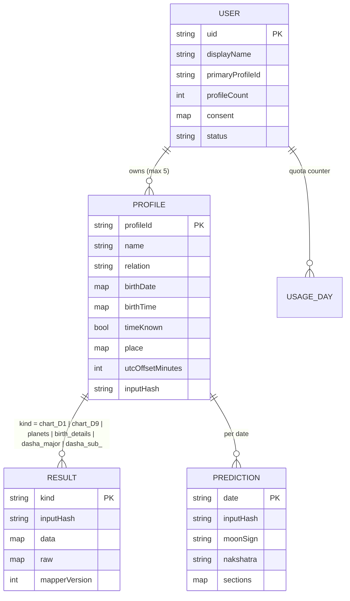

# Data Model, Validation and Migrations (Phase 4)

- **Status:** Draft. Awaiting approval (Phase 4 gate)
- **Date:** 2026-10-17
- **Store:** Firestore (native mode). Accessed **only** by the API's service account. Security rules deny all client access.

---

## 1. Principles

1. **Store only what the features need.** Email and sign-in identity live in Firebase Auth and are not copied into Firestore.
2. **Ownership comes from the path.** All personal data lives under `users/{uid}/…`. The `uid` always comes from the verified token and never from request input.
3. **Every document has a `schemaVersion`.** Shapes are enforced by zod schemas in `packages/shared`.
4. **Provider results are stored twice:**
   - as the **raw response**, so a mapping bug can be fixed without spending credits;
   - as the **mapped internal model**, which is what the app reads.
5. **Results are tied to an `inputHash`.** If the birth inputs change, cached results are invalid by construction.
6. **Operational data is pseudonymous.** Logs, audit events, and call metadata use `uidHash = HMAC-SHA256(uid, pepper)`. The pepper lives in Secret Manager. This means the logs can't be joined back to users without the secret.

---

## 2. Collections

```
users/{uid}
  profiles/{profileId}
    results/{kind}
    predictions/{yyyy-mm-dd}
  usage/{yyyy-mm-dd}
places/{queryHash}
placeIds/{placeId}
providerCalls/{autoId}
auditEvents/{autoId}
_migrations/{migrationId}
```



### 2.1 `users/{uid}`

| Field                    | Type                                           | Notes                                                                                                           |
| ------------------------ | ---------------------------------------------- | --------------------------------------------------------------------------------------------------------------- |
| `displayName`            | string \| null                                 | 1–50 chars. Optional.                                                                                           |
| `primaryProfileId`       | string \| null                                 | The profile used by default on Home.                                                                            |
| `profileCount`           | int 0–5                                        | Kept up to date inside the same transaction as profile create and delete. This is how the cap of 5 is enforced. |
| `consent`                | `{ privacyVersion, termsVersion, acceptedAt }` | Required before any profile is created. Supports the DPDP and GDPR record-keeping obligations.                  |
| `status`                 | `"active"` \| `"deleting"`                     | Set to `"deleting"` while the deletion cascade runs, so an interrupted cascade can be resumed.                  |
| `createdAt`, `updatedAt` | Timestamp                                      |                                                                                                                 |
| `schemaVersion`          | int                                            | Starts at 1.                                                                                                    |

### 2.2 `users/{uid}/profiles/{profileId}`

| Field                                     | Type                                                   | Notes                                                                                                                               |
| ----------------------------------------- | ------------------------------------------------------ | ----------------------------------------------------------------------------------------------------------------------------------- |
| `name`                                    | string                                                 | 1–60 chars, trimmed, control characters removed.                                                                                    |
| `relation`                                | `self` \| `partner` \| `family` \| `friend` \| `other` |                                                                                                                                     |
| `birthDate`                               | `{ year, month, day }`                                 | The **local** calendar date at the birthplace.                                                                                      |
| `timeKnown`                               | bool                                                   |                                                                                                                                     |
| `birthTime`                               | `{ hour, minute }` \| null                             | Null exactly when `timeKnown = false`.                                                                                              |
| `place`                                   | `{ name, countryCode, lat, lon, timezoneId }`          | Copied from the place search result. `lat` and `lon` are rounded to 4 decimal places (about 11 m). `timezoneId` is an IANA zone ID. |
| `utcOffsetMinutes`                        | int                                                    | Computed with Luxon from `timezoneId` at the birth instant. If the time is unknown, it is computed at 12:00 local.                  |
| `offsetChoice`                            | `earlier` \| `later` \| null                           | Only set when the local time is ambiguous, i.e. falls inside a DST fall-back hour (see 4.3).                                        |
| `timeAssumedNoon`                         | bool                                                   | True when the time is unknown. Every reading built on this profile then shows the accuracy disclaimer.                              |
| `inputHash`                               | string                                                 | SHA-256 of the canonical JSON `{date, time-or-12:00, lat, lon, utcOffsetMinutes, ayanamsa:"lahiri", provider:"astrologyapi-v1"}`    |
| `createdAt`, `updatedAt`, `schemaVersion` |                                                        |                                                                                                                                     |

**When a profile is edited:**

- If a birth field changes (date, time, place, or offset choice), `inputHash` is recomputed, and the API **deletes** that profile's `results/*` and `predictions/*` in the same request.
- If only `name` or `relation` changes, cached results are kept.

### 2.3 `users/{uid}/profiles/{profileId}/results/{kind}`

| `kind`           | Provider endpoint | Allowed when the time is unknown?                                                                   |
| ---------------- | ----------------- | --------------------------------------------------------------------------------------------------- |
| `birth_details`  | `birth_details`   | yes, with noon assumed and the disclaimer shown                                                     |
| `planets`        | `planets`         | yes, but the app shows only sign and nakshatra, with the disclaimer. Degrees and houses are hidden. |
| `chart_D1`       | `horo_chart/D1`   | **no.** The API returns 409 `BIRTH_TIME_REQUIRED`.                                                  |
| `chart_D9`       | `horo_chart/D9`   | **no**                                                                                              |
| `dasha_major`    | `major_vdasha`    | **no**                                                                                              |
| `dasha_sub_<MD>` | `sub_vdasha/<MD>` | **no.** Fetched lazily, the first time the user opens that Mahadasha.                               |

**Fields on each result document:**

- `inputHash`
- `data`: the internal model
- `raw`: the provider JSON
- `provider: "astrologyapi"`
- `endpoint`
- `mapperVersion` (int)
- `fetchedAt`
- `schemaVersion`

**Design change from Phase 3:** we drop the `current_vdasha` call. Its answer depends on today's date, so it can't be cached forever. The app works out the "current" Maha and Antar dasha by finding which cached provider period contains _now_. This is a date lookup, not an astrological calculation. It saves 1 call per profile and keeps every result permanently cacheable.

### 2.4 `users/{uid}/profiles/{profileId}/predictions/{yyyy-mm-dd}`

| Field                               | Notes                                                                                                                                                                                      |
| ----------------------------------- | ------------------------------------------------------------------------------------------------------------------------------------------------------------------------------------------ |
| `date`                              | The user's local calendar date. The app sends it. The API accepts only dates within ±2 days of the server's UTC date (the user's local today ±1, plus up to 1 day of timezone difference). |
| `inputHash`                         |                                                                                                                                                                                            |
| `moonSign`, `nakshatra`             | As returned by the provider. They are shown to the user (FR-17).                                                                                                                           |
| `sections`                          | `{ health, emotions, profession, luck, personalLife, travel }`                                                                                                                             |
| `raw`, `fetchedAt`, `schemaVersion` |                                                                                                                                                                                            |
| `expireAt`                          | `date` + 90 days. A Firestore TTL policy removes old predictions.                                                                                                                          |

⚠ **Phase 7 check:** it's unclear which "today" the provider uses (IST or UTC?). Near midnight, the provider's "today" and the user's date might differ. The adapter must work out which date the response actually covers before writing it to the cache.

### 2.5 `users/{uid}/usage/{yyyy-mm-dd}` (UTC date)

- `providerCalls` (int): incremented in a transaction before each provider call.
- `expireAt`: 7 days later (TTL).
- The daily limit itself is config (env var `QUOTA_PROVIDER_CALLS_PER_DAY`). Its starting value is set after Phase 7 cost measurement. The proposed placeholder is 30.

### 2.6 Global collections (no direct personal data)

| Collection                         | Fields                                                                                                                                                                                | TTL      |
| ---------------------------------- | ------------------------------------------------------------------------------------------------------------------------------------------------------------------------------------- | -------- |
| `places/{sha256(normalizedQuery)}` | `query`, `results[]`, `fetchedAt`                                                                                                                                                     | 30 days  |
| `placeIds/{placeId}`               | Copy of one place from a search: `placeId`, `name`, `countryCode`, `lat`, `lon`, `timezoneId`, `expireAt`. Used by `resolvePlace` so that profiles can only reference searched places | 30 days  |
| `providerCalls/{id}`               | `endpoint`, `status`, `latencyMs`, `errorCode`, `attempt`, `uidHash`, `at`                                                                                                            | 30 days  |
| `auditEvents/{id}`                 | `type` (`account_created`, `account_deleted`, `profile_deleted`, `quota_exceeded`, `provider_auth_failed`), `uidHash`, `at`                                                           | 180 days |
| `_migrations/{id}`                 | `appliedAt`, `env`, `docsTouched`                                                                                                                                                     | keep     |

**Not stored as entities:**

- **Provider configuration:** env vars plus Secret Manager.
- **Subscriptions and payments:** not in the MVP.
- **Device or location data:** not collected.

---

## 3. Access, retention and deletion

| Data                           | Who can access                     | Retention                | When deleted                                                                    |
| ------------------------------ | ---------------------------------- | ------------------------ | ------------------------------------------------------------------------------- |
| `users/{uid}/**`               | The API, scoped to the token's uid | While the account exists | At account deletion, immediately and recursively                                |
| Profile and its subcollections | Same                               | While the profile exists | At profile deletion, recursively                                                |
| Predictions                    | Same                               | 90 days (TTL)            | TTL, or with the profile                                                        |
| Usage counters                 | API only                           | 7 days                   | TTL                                                                             |
| Places cache                   | API only                           | 30 days                  | TTL                                                                             |
| Provider call log              | API, plus ops via the GCP console  | 30 days                  | TTL                                                                             |
| Audit events                   | Ops                                | 180 days                 | TTL                                                                             |
| Firestore backups (GCS)        | Ops (restricted IAM)               | 30 days                  | Bucket lifecycle rule. Deleted users disappear from all backups within 30 days. |
| Firebase Auth record           | Firebase                           | While the account exists | Deleted during account deletion                                                 |

**Account deletion sequence (`DELETE /v1/me`):**

1. Require a recent sign-in, within the last 5 minutes. Firebase enforces this for sensitive operations.
2. Set `status = "deleting"`.
3. Recursively delete `users/{uid}`.
4. Delete the Firebase Auth user.
5. Write a `account_deleted` audit event using `uidHash`.

Each step is idempotent. A nightly job finds any `status = "deleting"` users and retries the steps.

---

## 4. Validation rules

The rules live in `packages/shared` and are used in **both** the app (instant feedback) and the API (enforcement).

### 4.1 Birth date and time

| Rule                                                                                          | Error code            |
| --------------------------------------------------------------------------------------------- | --------------------- |
| A real calendar date. Leap years are handled; 29 Feb 2001 is rejected.                        | `INVALID_DATE`        |
| 1900-01-01 ≤ date.                                                                            | `DATE_OUT_OF_RANGE`   |
| The local date-time at the birthplace is not in the future.                                   | `DATE_IN_FUTURE`      |
| `hour` is 0–23 and `minute` is 0–59, both integers. Seconds are not collected.                | `INVALID_TIME`        |
| `timeKnown = false` ⇒ `birthTime` must be null. `timeKnown = true` ⇒ `birthTime` is required. | `TIME_STATE_MISMATCH` |

### 4.2 Place

| Rule                                                                                                                               | Error code            |
| ---------------------------------------------------------------------------------------------------------------------------------- | --------------------- |
| The place must come from a search result. The API re-checks it against the `places` cache by ID, so free-text places are rejected. | `PLACE_NOT_RESOLVED`  |
| `lat` is in [-90, 90] and `lon` in [-180, 180]. Both are finite numbers.                                                           | `INVALID_COORDINATES` |
| `timezoneId` exists in the IANA database (Luxon `isValidZone`).                                                                    | `INVALID_TIMEZONE`    |

### 4.3 Time zones and DST

The local time is resolved with Luxon `DateTime.fromObject({...}, { zone: timezoneId })`. The result's offset becomes `utcOffsetMinutes`.

There are two special cases.

**Gap (spring forward).** The local time never existed, for example 02:30 on a US DST start date.

- The API rejects it with `TIME_IN_DST_GAP`.
- The app explains: "Clocks jumped forward at this time in <place>. Please check the birth time."

**Overlap (fall back).** The local time happened twice.

- The API returns `TIME_AMBIGUOUS` together with both possible offsets.
- The app asks the user "first or second occurrence?", and the answer is stored in `offsetChoice`.

**Historical offsets.** These come from the tzdb history: India's pre-1955 and wartime offsets, for example, and US and UK DST rule changes. tzdb history is less reliable before 1970 in some regions, so there are two safeguards:

- A **fixture set of at least 20 cases** is cross-checked against the provider's `timezone_with_dst` in Phase 7.
- Any mismatch is documented and resolved before launch.

### 4.4 Text fields

- `name`: NFC normalized, trimmed, 1–60 chars, Unicode letters, marks, spaces, `.'-` allowed.
- `displayName`: same rules, 1–50 chars.
- Request bodies above 16 KB are rejected. Unknown JSON fields are rejected (zod `.strict()`).

### 4.5 Provider responses

Each endpoint has a zod schema.

- Numbers and booleans that arrive as strings are coerced.
- Dasha dates in `d-m-yyyy H:m` form are parsed strictly. They are interpreted in the birth offset and stored as UTC ISO strings.
- `horo_chart` must contain exactly 12 houses. `planets` must contain all 9 grahas plus the Ascendant.
- A schema failure raises `ProviderMalformedError`. The response is logged without birth data and **not cached**.

---

## 5. Migration strategy

Firestore has no DDL, so "migrations" here means changes to document shapes, indexes, and rules.

| Change type                       | Approach                                                                                                                          |
| --------------------------------- | --------------------------------------------------------------------------------------------------------------------------------- |
| Adding an optional field          | Code tolerates the field being absent. No migration needed.                                                                       |
| Renaming or restructuring a field | Bump `schemaVersion`. The reader upgrades old documents on read (lazy migration). A one-off script back-fills the rest if needed. |
| Mapper bug fix                    | Bump `mapperVersion`. A script re-maps `data` from the stored `raw`. This uses **zero provider credits**.                         |
| Indexes and security rules        | `infra/firebase/firestore.indexes.json` and `firestore.rules` are kept in git and deployed with the Firebase CLI from CI.         |

**Migration scripts** live in `services/api/migrations/NNNN_description.ts`. Each script:

- is **idempotent**;
- supports `--dry-run`;
- records its run in `_migrations/{id}`.

The run order is:

1. Local emulators.
2. Staging.
3. **Backup export.**
4. Prod, with manual approval.

To roll back, deploy the previous API version, which still reads both schema versions. In the worst case, restore from the export.

---

## 6. API surface (for reference; it shapes the modules)

All routes are under `/v1`. They require a Firebase ID token, plus App Check in staging and prod.

| Method               | Path                                        | Purpose                                                        |
| -------------------- | ------------------------------------------- | -------------------------------------------------------------- |
| GET                  | `/healthz`                                  | Liveness. Public.                                              |
| GET / PATCH          | `/me`                                       | Profile and consent                                            |
| DELETE               | `/me`                                       | Account deletion                                               |
| GET                  | `/places?q=`                                | Place search (≥ 3 characters)                                  |
| GET / POST           | `/profiles`                                 | List and create profiles                                       |
| GET / PATCH / DELETE | `/profiles/{id}`                            | Read, edit, and delete a profile                               |
| GET                  | `/profiles/{id}/planets`                    | Planet table. Also works when the birth time is unknown (FR-8) |
| GET                  | `/profiles/{id}/chart?type=D1\|D9`          | Chart and planet table                                         |
| GET                  | `/profiles/{id}/dasha`                      | Mahadasha list plus the current period                         |
| GET                  | `/profiles/{id}/dasha/{md}`                 | Antardashas for one Mahadasha                                  |
| GET                  | `/profiles/{id}/prediction?date=yyyy-mm-dd` | Daily prediction                                               |

Errors use a stable shape, `{ error: { code, message, retryable } }`. The full contract is written in Phase 5.
